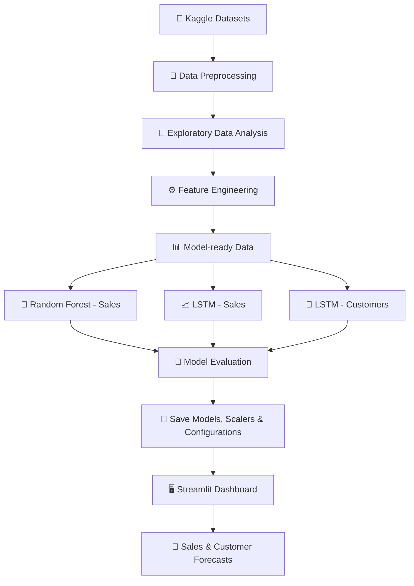

# 🏪 Rossmann Store Sales Forecasting

<h3 align="center">📊 Daily Sales & Customer Forecasting with Machine Learning, Deep Learning and Streamlit</h3>

<p align="center">
  
  
  
  
  
</p>

<p align="center">
  <b>An end-to-end retail forecasting project for predicting daily store sales and customer traffic.</b>
</p>

---

## 📌 Table of Contents

- [Project Overview](#-project-overview)
- [Business Objectives](#-business-objectives)
- [Dataset Overview](#-dataset-overview)
- [Technology Stack](#️-technology-stack)
- [Project Workflow](#-project-workflow)
- [Exploratory Data Analysis](#-exploratory-data-analysis)
- [Feature Engineering](#️-feature-engineering)
- [Predictive Models](#-predictive-models)
- [Model Evaluation](#-model-evaluation)
- [Streamlit Dashboard](#️-streamlit-dashboard)
- [Dashboard Screenshots](#-dashboard-screenshots)
- [Dashboard Video Demo](#-dashboard-video-demo)
- [Repository Structure](#-repository-structure)
- [Installation & Setup](#️-installation--setup)
- [Business Applications](#-business-applications)
- [Limitations & Future Improvements](#️-limitations--future-improvements)
- [Author](#-author)

---

## 🌟 Project Overview

**Rossmann Store Sales Forecasting** is an end-to-end Data Science project built around the Rossmann Store Sales Kaggle dataset.

The project analyzes historical store sales, customer traffic, promotional activities, holidays, seasonal patterns, and store characteristics to develop forecasting models that support retail decision-making.

Three predictive models are implemented:

- 🌳 **Random Forest Regressor** – predicts daily store sales.
- 📈 **Sales LSTM** – forecasts daily sales using historical time-series sequences.
- 👥 **Customers LSTM** – forecasts daily customer traffic using historical customer sequences.

The trained models are integrated into an interactive **Streamlit dashboard**, where users can provide store information, upload daily input data, and generate forecasts.

## 🎯 Business Objectives

- Understand historical sales and customer purchasing patterns.
- Analyze the impact of promotions, holidays, and seasonal events.
- Explore relationships between sales, customer traffic, and store characteristics.
- Build Machine Learning and Deep Learning forecasting models.
- Forecast daily sales and customer traffic.
- Present model predictions through an interactive dashboard.
- Support retail planning through data-driven insights.

## 📂 Dataset Overview

**Dataset Source:** [Rossmann Store Sales – Kaggle Competition](https://www.kaggle.com/competitions/rossmann-store-sales/data)

The project uses three primary Kaggle datasets:

| Dataset | Description |
|---|---|
| `train.csv` | Historical daily store sales, customer counts, and promotional information |
| `test.csv` | Store-day records for which sales predictions are required |
| `store.csv` | Store-level information, assortment, competition, and promotion details |
| `sample_submission.csv` | Expected Kaggle submission format |

### Dataset Scale

| Dataset | Records | Columns |
|---|---:|---:|
| Training data | 1,017,209 | 9 |
| Test data | 41,088 | 8 |
| Store data | 1,115 | 10 |

The training data contains daily store-level sales and customer observations. Store metadata is joined to the train and test datasets to support store-aware analysis and modelling.

## 🛠️ Technology Stack

<p align="center">
  
  
  
  
  
  
  
  
</p>

| Tool / Library | Purpose |
|---|---|
| Python | Data analysis and model development |
| Pandas & NumPy | Data manipulation and numerical operations |
| Matplotlib & Seaborn | Exploratory data visualization |
| Scikit-learn | Preprocessing, Random Forest, and model evaluation |
| TensorFlow / Keras | LSTM model development |
| Joblib / Pickle | Saving and loading model artifacts |
| JSON | Model configuration storage |
| Streamlit | Interactive forecasting dashboard |
| Jupyter Notebook | Analysis and experimentation |
| Git & GitHub | Version control and project hosting |

## 🔄 Project Workflow



## 🧹 1. Data Preprocessing

Prepared the raw datasets for analysis and model development.

### Key activities

- Loaded the Rossmann training, testing, and store datasets.
- Inspected dataset dimensions, data types, and statistical summaries.
- Merged store-level information with train and test records.
- Examined missing values and handled them using appropriate strategies.
- Checked duplicate records and inconsistent values.
- Converted date-related columns into appropriate datetime formats.
- Investigated outliers in sales, customer, and store-related variables.
- Prepared clean datasets for exploratory analysis and modelling.

## 🔎 2. Exploratory Data Analysis (EDA)

Performed univariate and multivariate analysis to understand store performance and customer behaviour.

### Analysis areas

- Daily, weekly, monthly, and yearly sales patterns.
- Customer traffic and its relationship with sales.
- Store type and assortment analysis.
- Promotion and non-promotion sales comparison.
- State holidays and school holiday impact.
- Seasonal events and calendar patterns.
- Competition distance and store performance.
- Sales and customer distribution across stores.
- Store opening and closing behaviour.

### 📷 EDA Screenshots

Add your actual notebook charts to the `screenshots/eda/` folder and update the image paths below.

| Analysis | Screenshot |
|---|---|
| Sales Distribution | `screenshots/eda/sales_distribution.png` |
| Customer Distribution | `screenshots/eda/customer_distribution.png` |
| Sales & Customers Relationship | `screenshots/eda/sales_customers.png` |
| Promotion Analysis | `screenshots/eda/promotion_analysis.png` |
| Holiday & Seasonal Analysis | `screenshots/eda/holiday_analysis.png` |
| Store Type Analysis | `screenshots/eda/store_type_analysis.png` |

Example image insertion:

```markdown

```

## ⚙️ 3. Feature Engineering

Created additional features to capture calendar patterns, promotional effects, and store-level behaviour.

### Feature groups

- **Calendar features:** Year, month, day, weekday, weekend, and month position.
- **Holiday features:** Holiday indicators and relative holiday timing.
- **Promotion features:** Promotional activity and related indicators.
- **Store features:** Store type, assortment, and competition information.
- **Time-series features:** Historical sequences for LSTM forecasting.

Feature preparation was designed around the input requirements of the individual models.

## 🤖 4. Predictive Models

Three separate models were developed for sales and customer forecasting.

### 🌳 Model 1 – Random Forest Regressor (Sales)

A tree-based ensemble Machine Learning model used to predict daily store sales.

**Approach**

- Uses engineered calendar, promotional, and store-related features.
- Learns non-linear relationships between input variables and sales.
- Produces daily sales predictions.
- Evaluated using regression performance metrics.

**Validation Results**

| Metric | Score |
|---|---:|
| MAE | Add your result |
| RMSE | Add your result |
| RMSPE | Add your result |
| R² Score | Add your result |

### 📈 Model 2 – LSTM (Sales Forecasting)

A Long Short-Term Memory neural network developed to learn sequential patterns in historical daily sales.

**Architecture and training approach**

- Uses a 7-day historical input window.
- Uses stacked LSTM layers with 64 and 32 units.
- Includes Dropout layers with a rate of 0.2.
- Uses scaled input and target values.
- Uses chronological validation data.
- Applies EarlyStopping during training.

**Validation Performance**

| Metric | Score |
|---|---:|
| R² Score | **0.8088** |
| MAE | **830.84** |
| RMSE | **1284.40** |
| RMSPE | **16.81%** |

### 👥 Model 3 – LSTM (Customer Forecasting)

A separate Long Short-Term Memory model developed to predict daily customer traffic.

**Architecture and training approach**

- Uses a 7-day historical customer input window.
- Uses stacked LSTM layers with 64 and 32 units.
- Includes Dropout layers with a rate of 0.2.
- Uses separate MinMaxScalers for input and target values.
- Uses chronological training and validation splitting.
- Applies EarlyStopping with restoration of the best weights.
- Applies a non-negative constraint to predicted customer counts.

**Validation Performance**

| Metric | Score |
|---|---:|
| R² Score | Add your customer LSTM result |
| MAE | Add your customer LSTM result |
| RMSE | Add your customer LSTM result |
| RMSPE | Add your customer LSTM result |

> Replace the placeholders with the final validation results from your notebook before publishing.

## 📊 5. Model Evaluation

The models are evaluated using regression metrics.

| Metric | Description |
|---|---|
| MAE | Measures the average absolute difference between actual and predicted values |
| RMSE | Measures prediction error while penalizing larger errors |
| RMSPE | Measures percentage-based prediction error; zero actual values are excluded |
| R² Score | Measures the proportion of target variance explained by the model |

The metrics should be interpreted in the context of each model's prediction target. Sales and customer forecasts are evaluated separately.

## 💾 6. Model Serialization

The trained models and supporting artifacts are saved for reuse in the Streamlit application.

### Saved artifacts

| Model | Saved components |
|---|---|
| Random Forest – Sales | Trained model and required preprocessing artifacts |
| LSTM – Sales | Model, scalers, and configuration |
| LSTM – Customers | Model, input scaler, target scaler, and configuration |

Timestamped filenames are used for model artifacts to help identify saved training versions.

## 🖥️ 7. Streamlit Forecasting Dashboard

The Streamlit application provides a user interface for generating forecasts without manually running the model-training notebooks.

### Dashboard capabilities

- 🏬 Enter or select store information.
- 📁 Upload daily forecasting information through a CSV file.
- ✅ Validate uploaded CSV data.
- 🌳 Generate sales predictions using Random Forest.
- 📈 Generate sales forecasts using the Sales LSTM model.
- 👥 Generate customer forecasts using the Customers LSTM model.
- 📊 View model performance metrics.
- 🔮 Review forecast outputs for the requested dates.

### Dashboard Screenshots

**Add your actual Streamlit application screenshots to the `screenshots/dashboard/` folder.**

#### 1. Dashboard Home


#### 2. Model Performance Comparison


#### 3. Store Information & CSV Upload


#### 4. Sales Forecasting Results


#### 5. Customer Forecasting Results


> The image paths above are placeholders. Add your screenshots using the same filenames or change the Markdown paths to match your files.

## 🎥 8. Streamlit Dashboard – Video Explanation

Watch the project demonstration to see how the dashboard works, how input data is uploaded, and how the three forecasting models generate predictions.

<p align="center">
  <a href="YOUR_YOUTUBE_OR_VIDEO_LINK">
    
  </a>
</p>

<p align="center">
  <b>▶️ Click the preview image above to watch the dashboard walkthrough.</b>
</p>

**Video contents**

- Dashboard overview and navigation.
- Store information input.
- Uploading and validating the forecasting CSV.
- Random Forest sales prediction.
- LSTM sales forecasting.
- LSTM customer forecasting.
- Reviewing prediction outputs.

**How to add your video**

1. Record your Streamlit dashboard walkthrough.
2. Upload the video to YouTube, or use a GitHub-hosted video link.
3. Save a representative video thumbnail as `screenshots/dashboard/video_thumbnail.png`.
4. Replace `YOUR_YOUTUBE_OR_VIDEO_LINK` with the actual video URL.

GitHub README files do not provide reliable native playback for every uploaded video format. A clickable thumbnail is a clean way to link to the full demonstration.

## 💼 9. Business Applications

The forecasting solution demonstrates how predictive analytics can support retail operations.

- 📦 **Inventory Planning:** Use expected sales to support stock planning.
- 👥 **Staff Planning:** Use customer traffic forecasts to help plan staffing.
- 🎯 **Promotion Analysis:** Understand how promotional periods relate to sales and customer activity.
- 📅 **Seasonal Planning:** Identify recurring calendar and seasonal patterns.
- 🏬 **Store-level Decisions:** Compare expected performance across stores.
- 📈 **Business Forecasting:** Support operational decisions with model-generated estimates.

## 📁 Repository Structure

```text
Rossmann-Store-Sales-Forecasting/
│
├── data/
│   ├── train.csv
│   ├── test.csv
│   ├── store.csv
│   ├── train_merged.csv
│   └── test_merged.csv
│
├── models/
│   └── Random Forest artifacts
│
├── deeplearning/
│   ├── Sales LSTM artifacts
│   └── Customers LSTM artifacts
│
├── screenshots/
│   ├── eda/
│   └── dashboard/
│
├── notebooks/
│   └── Project analysis and model development
│
├── app.py
├── requirements.txt
└── README.md
```

*Update this example to match your actual repository. Large datasets and model artifacts may be excluded from GitHub using `.gitignore` or stored separately.*

## ⚙️ Installation & Setup

### 1. Clone the repository

```bash
git clone https://github.com/YOUR_USERNAME/YOUR_REPOSITORY.git
cd YOUR_REPOSITORY
```

### 2. Create a virtual environment

```bash
python -m venv venv
```

### 3. Activate the environment

**Windows:**

```bash
venv\Scripts\activate
```

### 4. Install dependencies

```bash
pip install -r requirements.txt
```

### 5. Run the Streamlit dashboard

```bash
streamlit run app.py
```

> Ensure that the required model artifacts, configuration files, scalers, and input data are available in the paths expected by the application.

## ⚠️ Project Notes & Limitations

- Forecast quality depends on the quality and availability of historical input data.
- The Random Forest and LSTM models use different modelling approaches and input requirements.
- Time-series forecasts depend on the historical sequence supplied to the LSTM models.
- The validation metrics shown in this README represent the recorded Sales LSTM validation results; update the other model metrics using their final evaluation outputs.
- This project is a forecasting demonstration and should be validated with current business data before operational use.

## 🔮 Future Improvements

- Experiment with additional time-series forecasting architectures.
- Improve model performance through hyperparameter optimization.
- Add forecast confidence intervals.
- Incorporate external factors such as weather and local events.
- Add downloadable prediction reports.
- Deploy the Streamlit dashboard to a cloud platform.
- Automate model retraining and monitoring.

## 👨‍💻 Author

**Saayan Samanta**

*Aspiring Data Scientist | Python | Machine Learning | Deep Learning | Data Analytics*

- GitHub: [YOUR_GITHUB_PROFILE](https://github.com/YOUR_USERNAME)
- LinkedIn: [YOUR_LINKEDIN_PROFILE](https://www.linkedin.com/)

---

## ⭐ Support This Project

If you find this project useful or interesting, please consider giving this repository a **star** ⭐ on GitHub!

<p align="center">
  <a href="https://github.com/YOUR_USERNAME/YOUR_REPOSITORY">
    
  </a>
</p>

<p align="center">
  <b>Thanks for visiting! Happy Learning & Forecasting 🚀</b>
</p>

<p align="center">
  <b>Turning Retail Data into Actionable Forecasts 📊</b>
</p>
